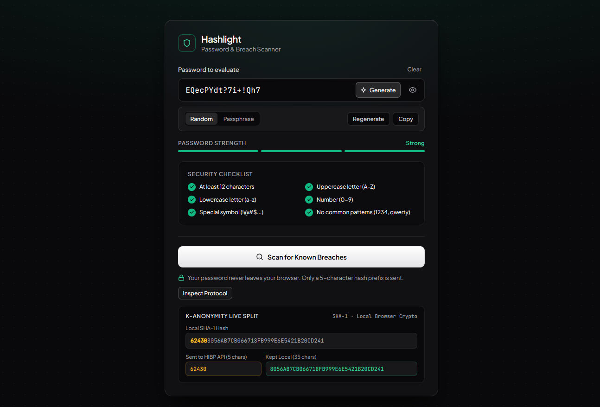

# Hashlight

Password strength checker and breach scanner that runs in your browser.

**[Live demo](https://ganat1337.github.io/hashlight-checker/)**



Your password never leaves your browser. Only a 5-character hash prefix is sent.

## Features

- **Live strength meter** with three levels (weak, medium, strong), updated on every keystroke.
- **Requirements checklist** with six rules: 12+ characters, uppercase, lowercase, number, symbol,and no common patterns (a short built-in list of 16 very common passwords, keyboard walks, sequences, repeated characters).
- **Breach scan** using the Have I Been Pwned Pwned Passwords API with k-anonymity (see below).
- **Password generator** using `crypto.getRandomValues` with rejection sampling (no modulo bias): a 16-character random password, or a a passphrase of 7 random capitalized words from a 160-word list plus a digit (about 54 bits of entropy).
- **Protocol inspector** that shows the local SHA-1 hash split into the part that is sent and the part that stays local.
- Loading and error states, including offline, and a responsive layout.

## How k-anonymity works

```
password ──(SHA-1 in your browser)──▶ 40-character hash
                                        ├─ first 5 characters ──▶ sent to api.pwnedpasswords.com/range/{prefix}
                                        └─ remaining 35 characters ◀── matched locally against the returned list
```

1. The password is hashed locally with the Web Crypto API.
2. Only the first 5 hex characters of the hash are sent.
3. The API returns every known breached hash that shares that prefix (hundreds of entries), so it cannot tell which one is yours.
4. The remaining 35 characters are compared locally, and the breach count is shown if there is a match.

## Known limitations

- **"Not found" does not mean "safe".** The scan only checks known breaches.
- **Strength is a heuristic**, based on rules and patterns. It is not a full entropy estimate.
- The passphrase wordlist is small (160 words). Longer or random passwords are stronger.
- Hashing needs a secure context (`https://` or `http://localhost`).
- The common-pattern check uses a short built-in list of 16 entries, not a full dictionary. Words like "elephant" are not flagged. The breach scan is the better check for commonly used passwords.

## Run locally

No build step. Open the folder with a static server, for example:

```bash
python -m http.server 8000
```

then visit `http://localhost:8000`. (Or use the VS Code Live Server extension.)

## Tech

HTML, CSS, vanilla JavaScript (ES modules), Web Crypto API.

## Credits

Breach data from [Have I Been Pwned](https://haveibeenpwned.com/Passwords) by Troy Hunt.

## License

[MIT](LICENSE), copyright (c) 2026 Ganat Ahmed